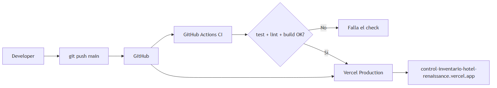
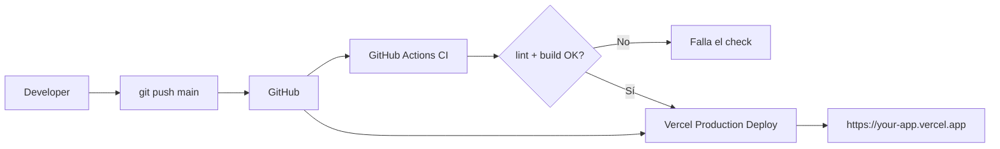
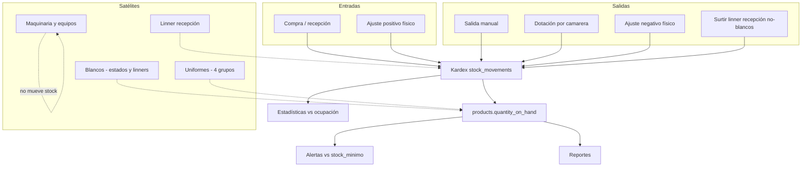
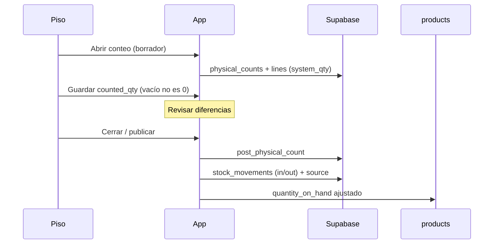

# Ejemplo de pipeline — Hotel Demo

Documento de referencia del **pipeline de entrega (CI/CD)** y del **pipeline operativo de inventario**.



---

## 1. Pipeline CI/CD (código → producción)

Flujo real del proyecto:



### Etapas

| Etapa | Qué hace | Dónde |
|-------|----------|--------|
| 1. Commit | Cambios en el código | Local / Cursor |
| 2. Push | Sube a `main` | GitHub |
| 3. CI | `npm ci` → `test` → `lint` → `build` | GitHub Actions (`.github/workflows/ci.yml`) |
| 4. Deploy | Build + publish producción | Vercel (integración Git) |
| 5. Runtime | App + Auth + RLS | Vercel + Supabase |

### Variables en producción (Vercel)

- `NEXT_PUBLIC_SUPABASE_URL`
- `NEXT_PUBLIC_SUPABASE_ANON_KEY`
- `SUPABASE_SERVICE_ROLE_KEY` (solo servidor)

### Cómo se dispara

1. Push a `main` en `your-org/control-inventarios`
2. Vercel despliega automáticamente
3. En paralelo, Actions valida lint/build

---

## 2. Pipeline operativo de inventario (negocio)

Todos los módulos alimentan el **mismo stock** y el **kardex** (`stock_movements`).



Surtir blancos a un linner de piso **no** pasa por el kardex (sub-ubicación de `available`).

### Cadena lógica (resumen)

```
Entrada / salida / dotación / conteo físico / linner recepción (no-blancos)
        ↓
   Kardex (traza)
        ↓
   Existencia actualizada
        ↓
   Alertas · Reportes · Gráficas
```

### Ejemplo concreto: inventario físico



---

## 3. Pipeline de un cambio típico (día a día)

```text
1. Editar código (módulo / UI / action)
2. Probar en local: npm run dev
3. git add + commit (mensaje claro)
4. git push origin main
5. Esperar:
   - Actions: CI verde
   - Vercel: Deployment Ready
6. Verificar en producción (login + módulo tocado)
```

---

## 4. Archivos relacionados

| Archivo | Rol |
|---------|-----|
| `.github/workflows/ci.yml` | Pipeline CI (test + lint + build) |
| Vercel → Project → Git | Deploy automático desde `main` |
| `docs/product-spec.md` | Reglas de negocio del pipeline operativo |
| `docs/schema-mvp.md` / `schema-modules.md` | Tablas que alimentan el kardex |

---

*Hotel Demo — Control de inventarios*
