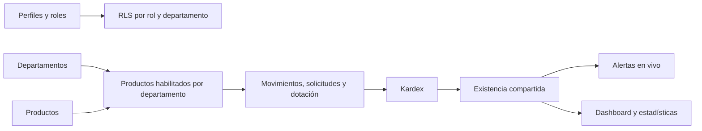

# Maduración del sistema — Roadmap por fases

> **Documento histórico (agosto 2026).** Las cuatro fases están en `main`. Roles, menú y solicitudes descritos aquí ya no coinciden con producción: cargos actuales en `src/lib/auth/modules.ts`; el módulo Solicitudes se retiró. Spec vigente: `docs/product-spec.md`.

> Fuente de requisitos original: plan Cursor `maduracion_sistema_fases` + `docs/product-spec.md` + invariantes de dominio (stock compartido, kardex, RLS).

**Goal:** Madurar el sistema en cuatro entregas desplegables, cada una shippable a producción de forma independiente.

**Prod:** https://your-app.vercel.app

## Orden de entrega

| Fase | Plan detallado | Contenido | Estado |
|------|----------------|-----------|--------|
| 1 | [2026-08-18-maduracion-fase-1-gobierno-catalogo.md](./2026-08-18-maduracion-fase-1-gobierno-catalogo.md) | Roles/RLS, Departamentos, Usuarios, catálogo editable, alertas Realtime, Solicitudes imprimibles + Vitest/CI | Hecha en `main` |
| 2 | [2026-08-18-maduracion-fase-2-blancos-fisico.md](./2026-08-18-maduracion-fase-2-blancos-fisico.md) | Blancos alineados a stock compartido + Inventario Físico robusto | Hecha |
| 3 | [2026-08-18-maduracion-fase-3-dotacion-uniformes-maquinaria.md](./2026-08-18-maduracion-fase-3-dotacion-uniformes-maquinaria.md) | Dotación camarera, Uniformes, Maquinaria | Hecha |
| 4 | [2026-08-18-maduracion-fase-4-reportes-dashboard.md](./2026-08-18-maduracion-fase-4-reportes-dashboard.md) | Reportes, Dashboard, Estadísticas con datos reales | Hecha |

## Arquitectura objetivo

## Invariantes globales (todas las fases)

- Existencia: `anterior + entradas − salidas` vía `stock_movements` + trigger; no bypassear kardex.
- Módulos comparten el mismo stock (`products.quantity_on_hand`).
- Sin salidas a existencia negativa (salvo política explícita documentada).
- RLS obligatorio; helpers `SECURITY DEFINER` sin recursión en `profiles`.
- UI en español; IDs/columnas en inglés.
- Cada fase: migración versionada → `npm test` → `lint` → `build` → commit → push `main` → verificar Vercel.

## Roles objetivo (Fase 1)

| Rol DB | Quién | Alcance |
|--------|-------|---------|
| `admin` | Administración | Global |
| `mrla` | Ama de Llaves / operación | Catálogo y operación global |
| `human_resources` | Capital Humano | Personal y uniformes |
| `department_user` | Usuario de departamento | Escritura solo en su depto + productos habilitados |

Mapeo desde roles actuales: `supervisor` → `mrla`; `staff` → `department_user`; `readonly` → `department_user` (sin escritura hasta asignar departamento y productos).

## Criterio de cierre por fase

1. Migración aplicada en Supabase (MCP `apply_migration` o CLI) + Advisors sin críticos de RLS.
2. CI verde (`test` + `lint` + `build`).
3. Smoke en prod: login, rol correcto, flujo principal de la fase.
4. Docs actualizados: `docs/product-spec.md`, `docs/manual-usuario.md`, schema docs afectados.
5. Solo entonces iniciar la siguiente fase (nuevo plan detallado).

### Cierre Fase 1 (2026-08-18)

- Fase 1 está en `main` (`06bf856`) y las fases 2, 3 y 4 quedaron cerradas sobre ese código.
- El catálogo del listado escaneado vive en `20261003023000_catalog_pdf_departments.sql`.
